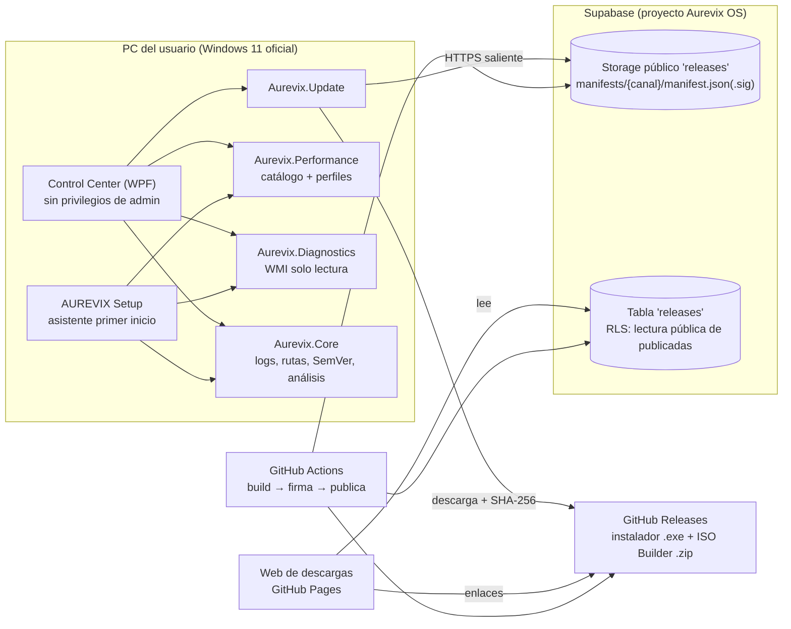
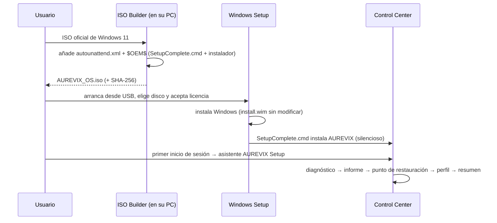

# Arquitectura de AUREVIX OS

## Visión general

## Módulos

| Proyecto | Responsabilidad | Plataforma |
|---|---|---|
| `Aurevix.Core` | Rutas, logs con retención, SemVer, modelos de diagnóstico y **analizador** (lógica pura) | .NET 8 (cualquier SO) |
| `Aurevix.Update` | Manifiesto, firma/verificación ECDSA, cliente de actualización, historial para rollback | .NET 8 (cualquier SO) |
| `Aurevix.Performance` | Catálogo de ajustes, perfiles, motor con copia de seguridad y reversión; acceso al registro y a `powercfg` detrás de interfaces | .NET 8 (la parte Windows está aislada) |
| `Aurevix.Diagnostics` | Recopilación WMI/CIM y API COM de Windows Update (solo lectura), escritura de informes | Windows |
| `Aurevix.ControlCenter` | Interfaz WPF, bandeja, instancia única, asistente de primer inicio, ventana de actualización | Windows |
| `tools/Aurevix.ReleaseTool` | Generar claves, crear y firmar manifiestos | .NET 8 |

La lógica con reglas importantes (firma, rollout, análisis de diagnóstico, motor de ajustes) vive en proyectos **sin dependencias de Windows** para poder probarla de forma automática en CI.

## Privilegios

- La interfaz se ejecuta siempre `asInvoker` (nunca como administrador).
- Los ajustes del catálogo actual son solo `HKCU`, por lo que no necesitan elevación.
- Las acciones que sí requieren permisos (punto de restauración, instalar una actualización) piden **UAC puntualmente**.
- El servicio local con privilegios mínimos (Hito 4) **no está implementado**; cuando exista, será el único con permisos elevados y expondrá una API local autenticada.

## Flujo de instalación

## Flujo de actualización

1. El mantenedor empuja la etiqueta `vX.Y.Z`.
2. GitHub Actions compila, prueba, crea el instalador, firma el manifiesto y publica en GitHub Releases y Supabase.
3. El cliente consulta `manifests/{canal}/manifest.json` (al iniciar sesión + cada 4 h), verifica firma, canal, caducidad y secuencia.
4. Si hay versión nueva y el equipo entra en el despliegue gradual, aparece la **ventana de actualización**.
5. Al aceptar: descarga, verifica SHA-256 y tamaño, guarda el historial (para rollback) y lanza el instalador con **argumentos fijos**. Windows pide UAC.

Detalle del formato en [UPDATE_MANIFEST.md](UPDATE_MANIFEST.md).

## Datos y logs

`%LOCALAPPDATA%\Aurevix\`: `settings.json`, `state.json`, `logs\` (14 días), `reports\` (informes de diagnóstico), `backups\` (valores previos a cada cambio), `downloads\`. Los logs no recogen nombres de usuario, documentos ni historial. El usuario puede abrirlos, exportarlos o borrarlos desde Ajustes.

## Estrategia de pruebas

- **Automáticas (36, en CI Linux)**: SemVer, analizador de diagnóstico, firma y verificación, rollout, descarga con hash, catálogo y perfiles, aplicar/revertir/rollback automático.
- **Manuales en VM**: ver [VM_TESTING.md](VM_TESTING.md).
- **Pendiente**: pruebas de UI y de instalación/actualización/rollback end-to-end en Windows, hardware distinto y GMKtec K12.
